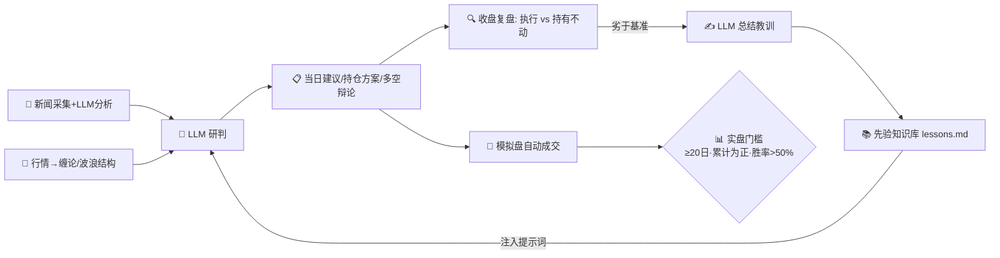

<div align="center">

# 🌊 StepWave

**会自我复盘的股票分析工作台**

*A self-reflective, self-hosted stock analysis workbench — Chan Theory × Elliott Wave × LLM*

[](https://www.python.org/)
[](https://flask.palletsprojects.com/)
[](https://github.com/akfamily/akshare)
[](https://docs.anthropic.com/)
[](LICENSE)
[](TODO.md)

</div>

---

它与常见"AI 荐股"项目最大的不同：**每天收盘后系统会审判自己**——模拟执行当日建议并与"持有不动"对比盈亏，建议更差就自动总结教训写入先验知识库，注入第二天的分析提示词。**建议 → 复盘 → 教训 → 更好的建议**，这个闭环是本项目的灵魂。

## ✨ 核心特性

| | 特性 | 说明 |
|---|---|---|
| 📰 | 新闻智能分析 | 财联社/新浪/东财三源采集，LLM 自动分 7 类、评重要性、写"对股票的影响"一句话 |
| 📐 | 确定性结构引擎 | 缠论（分型→笔→中枢→三类买卖点→MACD背驰）纯算法实现，非 LLM 看图说话 |
| 🌊 | 波浪理论测算 | 浪 2/3/4/5 斐波那契目标位 + 三大铁律校验 |
| 🐂🐻 | 多空辩论 | 牛熊双研究员各自陈词 + 主管裁决（含置信度与失效条件），灵感来自 TradingAgents |
| 💼 | 持仓顾问 | 输入股数成本 → 卖多少/留多少 + 挂单价，内置 A股/北交所交易规则与风控纪律 |
| 🔄 | 自我复盘闭环 | 收盘自动对比"执行建议 vs 持有不动"，劣于基准即沉淀教训为先验知识 |
| 🧪 | 模拟盘 | 建议在虚拟账户自动成交（防作弊：只执行盘前生成的方案），净值曲线 + 实盘门槛判定 |
| 🕳️ | 谷底观察窗 | 历史下跌笔持续分位 + 斐波时间窗 + ABC 时间比例 → 底部概率密集区（拒绝日期预言） |
| 🌐 | 三市场多源容错 | A股（含北交所）/港股/美股；东财→新浪→腾讯自动切换，单源限流不影响使用 |

## 🔄 方法论闭环



技术分析只回答"何时何价"，本项目再补两块：**风控纪律**（单笔风险≤2%、禁止摊平、止损锚定结构位——已写进提示词先验）和**有效性审计**（模拟盘统计证据）。

## 🖥️ 界面七大板块

| 板块 | 内容 |
|---|---|
| ① 今日要闻 | 分类卡片 + 重要性星级 + 个股影响 + 关键词搜索 |
| ② 走势展示 | K线 + MA5/20/60 + 成交量副图 + 缠论中枢框 + 笔 + 买卖点标记，现价 30 秒轮询 |
| ③ 当日买卖点位 | 关注列表每只的动作/仓位/挂单/止损 |
| ④ 总体研判 + 个股查询 | 上证+纳指结构研判；任意代码即时分析 + 🐂🐻多空辩论 |
| ⑤ 持仓顾问 | 卖多少/留多少 + 加仓价/清仓触发价/止损 |
| ⑥ 收盘复盘 | 执行建议 vs 持有不动的当日盈亏对比 + 教训展示 |
| ⑦ 谷底观察窗 + 模拟盘 | 底部时间观察窗 + 价格底候选；模拟盘净值曲线与实盘门槛 |

页面顶部有**今日摘要条**：大盘多空灯 · 建议总仓位 · 模拟盘累计差额 · 新闻条数，打开即见全局。

## 🚀 快速开始

```bash
git clone https://github.com/HansonZhuang/StepWave.git && cd StepWave

# 1. 环境（推荐 uv）
uv venv .venv --python 3.11
uv pip install -p .venv -r requirements.txt

# 2. 配置 LLM（Anthropic API 或任何兼容 /v1/messages 的代理）
cp .env.example .env && vi .env     # 填 ANTHROPIC_API_KEY
cp knowledge/lessons.example.md knowledge/lessons.md

# 3. 启动
source .env && cd webapp && ../.venv/bin/python app.py   # http://localhost:8688
```

命令行工具可独立使用：

```bash
.venv/bin/python scripts/fetch_stock.py 600519          # 任意A股: 拉数据+缠论结构报告
.venv/bin/python scripts/fetch_stock.py --us AAPL       # 美股 / --hk 00700 港股
.venv/bin/python scripts/elliott_calc.py 100 130 112    # 波浪斐波那契测算
.venv/bin/python webapp/bottom_window.py a 920725       # 谷底观察窗
```

## 🏗️ 架构与数据源

```
新闻(财联社/新浪/东财) ──→ news_service ── LLM分类/影响 ──┐
行情(东财→新浪→腾讯容错) → chan_analyzer 结构引擎 ────────┼→ advisor / portfolio / debate
指数(上证/纳指) ──────────────────────────────────────────┘           ↓
实时报价(新浪+腾讯) → 前端30s轮询      evaluator 收盘复盘 + paper_trader 模拟盘 → lessons.md ↺
```

| 数据 | 链路 |
|---|---|
| A股日线 | 东方财富(前复权) → 新浪(前复权；北交所走K线JSON) → 腾讯，自动容错 |
| 港股/美股日线 | 新浪(前复权) |
| 实时报价 | 新浪 hq(沪深/港/美/指数) + 腾讯(北交所)；当日K线缺失时由报价合成 |
| LLM | `LLM_FAST_MODEL` 批量新闻分类 / `LLM_SMART_MODEL` 建议·辩论·复盘教训 |

全部数据来自公开免费接口：请控制频率、遵守数据源条款，仅作个人研究。

## 🥊 与同类项目的定位差异

| 项目 | 定位 | 本项目的差异点 |
|---|---|---|
| [TradingAgents](https://github.com/TauricResearch/TradingAgents) (111k⭐) | 多智能体研究框架（分析师团队+辩论+风控） | 借鉴了其多空辩论机制，但本项目以**确定性缠论结构引擎**为地基，LLM 只做最后的综合判断 |
| [ai-hedge-fund](https://github.com/virattt/ai-hedge-fund) (62k⭐) | 投资大师人设智能体 + 回测 | 本项目面向**每日实际使用**：持仓方案、收盘复盘、教训闭环，而非历史回测研究 |
| [TradingAgents-CN](https://github.com/Liyi1998/TradingAgents-CN) | TradingAgents 的 A股本地化 | 本项目轻量得多（纯标准库结构引擎+Flask 单页），自托管零数据库，且有独有的**自我复盘先验闭环** |

一句话定位：**不是又一个"AI 荐股机器人"，而是一个带审计机制的个人技术分析工作台**——它的每一条建议都会在第二天被自己的复盘系统审判。

## 📚 内置知识库

- `docs/` 四份原创归纳笔记：缠论、艾略特波浪、蜡烛图与量价、交易系统与风控（凯利/头寸/纪律）
- `knowledge/lessons.md` 活的先验库：复盘教训自动追加，自动注入后续分析提示词
- 提示词全部内嵌于 `webapp/*.py`（新闻分类/大势研判/个股建议/持仓方案/多空辩论/教训总结），均要求严格 JSON 输出、点位锚定结构位

## ⚠️ 免责声明

本项目仅供**学习与研究**：

- 不构成任何投资建议，不保证盈利
- 所有"建议/点位/裁决"均为结构化信号+模型研判，存在错误可能
- 不提供实盘自动下单；模拟盘未计手续费与滑点
- 使用本软件产生的任何损失，作者不承担责任；投资决策请独立判断并咨询专业人士
- 过往表现（含模拟盘曲线）不代表未来结果

## 🗺️ Roadmap

见 [TODO.md](TODO.md)：A股特色数据（北向资金/龙虎榜）、复盘口径升级（手续费/T+1）、北交所复权修复、多级别联立等。

## 📄 License

[MIT](LICENSE) © 2026 HansonZhuang
